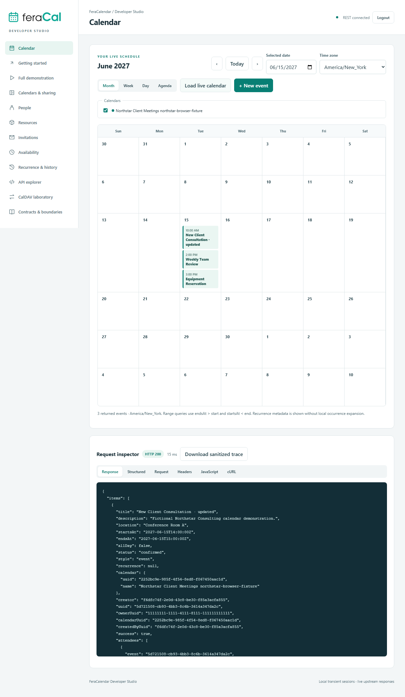

# FeraCalendar Developer Studio

A standalone React/Vite and Express developer workspace for FeraCal REST and CalDAV. It reuses the architectural patterns of [FeraRender Developer Studio](https://github.com/feradelinc/demo.ferarender) without a runtime dependency on that project.

The normal application always uses live upstream responses. Browser tests explicitly intercept requests with synthetic fixtures; fixture data is never a runtime fallback.

## Start locally

Requires Node 22.12 or later and npm.

```powershell
cd C:\Projects\Feradel\demo.feracalendar
npm ci
Copy-Item .env.example .env
# Set your authorized instance and service bases in the ignored .env.
npm run dev
# http://127.0.0.1:4179
```

Windows startup helper: `powershell -File scripts/start.ps1`. For a built local application, run `npm run build` and `npm start`.

Verified source defaults are FerAuth `http://localhost:10443`, Calendar REST `http://localhost:11400` and CalDAV `http://localhost:11410`. FerAuth's default differs from the example port 11000 used in the Render demo. Remote HTTPS bases require explicit entries in `ALLOWED_API_URLS`. The Studio binds to loopback and rejects remote Host headers; no public deployment is configured.

## What is implemented

- Interactive month, week, day and agenda calendar views backed by returned events, multiple-calendar selection, event editing and IANA-zone conversion.
- Calendars and effective access, sharing and role changes, people, resources, participation, availability, recurrence metadata and event history.
- A Northstar Consulting walkthrough that captures returned UUIDs, validates read-after-write and recurrence, and preserves created records until explicit scoped cleanup.
- Searchable canonical explorers: **30 public REST operations**, **30 CalDAV registrations**, plus supplemental health operations. The 4 HMAC lifecycle operations are documented without controls; 34 deprecated aliases are excluded.
- Separate Basic-auth CalDAV session, discovery and REPORT XML, ICS export/editing, ETags, conditional PUT/DELETE and conflict inspection.
- Redacted inspectors, JavaScript/cURL generation and privacy-preserving trace downloads.

Writes and cleanup are limited to records created in the current local session. Reading a preexisting calendar does not adopt it for mutation. Matters API is unchanged and outside the proxy's operating boundary.

## Qualification

```powershell
npm run audit
npm test
npm run build
npx playwright install chromium
npm run test:ui
npm run smoke
```

The Node suite exercises the actual proxy with explicit isolated upstream fixtures and selected real backend pure functions. Browser tests use explicit network interception. These tests establish local application behavior, not production API availability.

The smoke command refuses unless `SMOKE_NONPRODUCTION=true`, `INSTANCE_UUID`, `SMOKE_EMAIL` and `SMOKE_PASSWORD` are configured for an expressly authorized nonproduction account. Separate CalDAV credentials require `SMOKE_CALDAV=true`. Cleanup defaults to false. Reports under ignored `output/` retain created UUIDs and sanitized step evidence. No live account was supplied or exercised during implementation.

**Backend correction required:** the audited people controller invokes a missing `service.get`, so live people key/availability requests fail until the separate correction is reviewed and applied. Additional tenant-boundary, ETag and all-day discrepancies are recorded in [backend discrepancies](docs/backend-discrepancies.md). Review-only patches are included; no backend or infrastructure changes were made.

## Screenshots

The screenshots below show **explicitly intercepted synthetic browser-test sessions**, not a production account.



[Full walkthrough](docs/screenshots/workflow.png) ? [API explorer](docs/screenshots/api-explorer.png) ? [CalDAV laboratory](docs/screenshots/caldav-lab.png) ? [Mobile view](docs/screenshots/mobile.png)

## Documentation and examples

- [Developer guide](docs/developer-guide.md)
- [Audited operation coverage](docs/coverage.md)
- [Backend discrepancies and correction patches](docs/backend-discrepancies.md)
- [Qualification scope and results](docs/qualification.md)
- [REST/CalDAV HTTP requests](examples/calendar-and-caldav.http)
- [JavaScript event request](examples/calendar.js), [REST cURL](examples/calendar.curl), [CalDAV cURL](examples/caldav.curl)
- XML discovery/query/multiget/sync examples and a complete CRLF ICS file under `examples/`.

Existing repository history, origin and MIT [LICENSE](LICENSE) are preserved. Official Feradel/FeraCal SVG assets come from the Feradel WordPress theme; no generated replacement branding is used.
